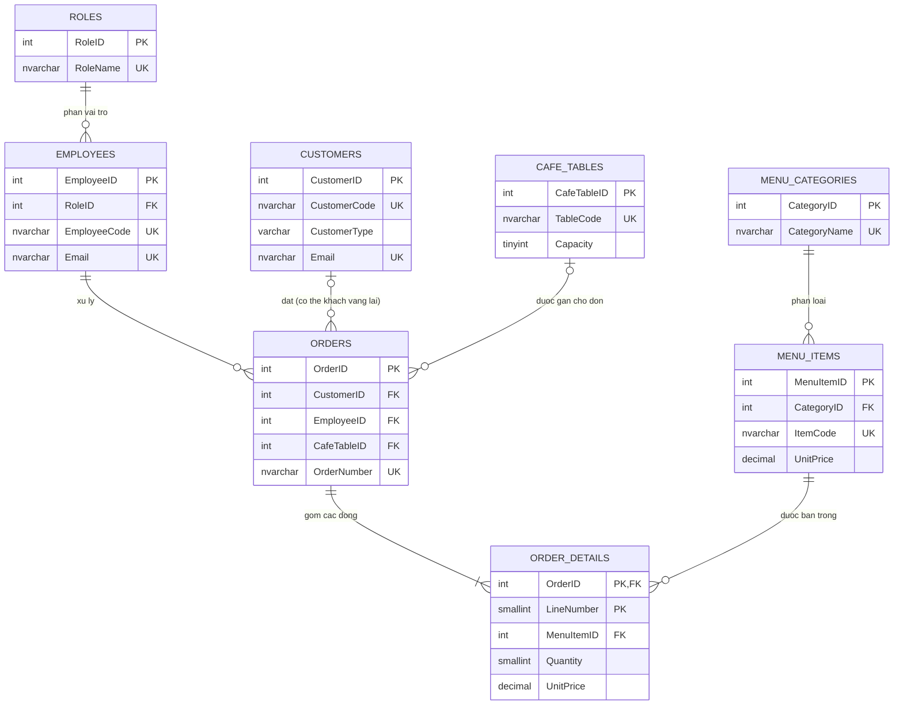

# Thiết kế cơ sở dữ liệu hệ thống quản lý quán cafe

## 1. Phát biểu bài toán

Hệ thống quản lý dữ liệu vận hành của một quán cafe, hỗ trợ nhân viên ghi nhận đơn hàng hằng ngày và giúp quản lý theo dõi menu, bàn, khách hàng, nhân sự và doanh thu. Cơ sở dữ liệu cần lưu lịch sử bán hàng chính xác, bảo toàn giá bán tại thời điểm đặt món và hạn chế dữ liệu trùng lặp.

### Vai trò và nghiệp vụ

- **Quản trị viên (Admin):** cấu hình danh mục món, tài khoản nhân viên và quyền sử dụng hệ thống.
- **Quản lý (Manager):** cập nhật menu, tình trạng bàn, thông tin nhân viên; theo dõi đơn và hoạt động của quán.
- **Thu ngân (Cashier):** tạo đơn, gắn nhân viên phục vụ, chọn bàn cho đơn dùng tại quán, ghi nhận phương thức và trạng thái thanh toán.
- **Nhân viên pha chế (Barista):** xem món trong đơn và cập nhật quá trình chuẩn bị.
- **Kế toán (Accountant):** tra cứu đơn và đối soát số liệu bán hàng; tổng tiền được tính từ các dòng chi tiết đơn hàng.
- **Khách hàng thành viên:** có hồ sơ, email đăng nhập và mật khẩu chỉ được lưu dưới dạng hash do tầng xác thực tạo.
- **Khách vãng lai:** có thể mua hàng không cần tài khoản; `Orders.CustomerID` để `NULL` nếu không cần lưu danh tính khách.

### Các nghiệp vụ chính

1. **Quản lý menu:** nhóm món vào danh mục; mỗi món có mã duy nhất, tên, giá hiện hành và cờ còn kinh doanh. Không xóa món đã phát sinh giao dịch; chuyển món sang không khả dụng để giữ lịch sử đơn.
2. **Quản lý bàn:** khai báo mã bàn, sức chứa, ghi chú và trạng thái đang hoạt động/ngừng hoạt động. Bàn có thể được gắn với đơn tại quán. Tình trạng đang có khách được xác định từ các đơn chưa kết thúc, không lưu lặp thành một trạng thái có thể mâu thuẫn với đơn.
3. **Quản lý đơn hàng/hóa đơn:** mỗi đơn có mã duy nhất, thời điểm tạo, loại đơn (dùng tại quán/mang đi), trạng thái xử lý, trạng thái thanh toán, nhân viên phụ trách và khách hàng nếu biết. Một đơn có một hoặc nhiều dòng món. Giá trong dòng đơn là **giá chốt tại thời điểm đặt**, không tự thay đổi khi giá menu đổi.
4. **Quản lý nhân viên:** lưu mã nhân viên, họ tên, điện thoại, email, ngày vào làm và trạng thái làm việc. Vai trò được tách thành bảng riêng để dùng chung và tránh lặp tên/mô tả quyền.
5. **Quản lý khách hàng:** lưu mã, loại hồ sơ (thành viên/khách), tên và thông tin liên hệ. Hồ sơ thành viên phải có email và hash mật khẩu; hồ sơ khách không có thông tin xác thực. Đơn mua không định danh vẫn được lưu với khách hàng `NULL`.

**Phạm vi dữ liệu:** mô hình tập trung vào menu, bàn, đơn, nhân viên và khách hàng. Chưa mô hình hóa đặt bàn trước, tồn kho/nguyên liệu, khuyến mãi hoặc nhiều lần thanh toán cho một đơn; các phần này có thể bổ sung bằng các thực thể độc lập khi nghiệp vụ yêu cầu.

## 2. Thực thể và thuộc tính

| Thực thể | Khóa chính / khóa ngoại | Thuộc tính chính và ràng buộc |
|---|---|---|
| `Roles` | PK `RoleID` | `RoleName` duy nhất, `Description`; danh mục vai trò nhân viên. |
| `MenuCategories` | PK `CategoryID` | `CategoryName` duy nhất, `Description`, `IsActive`; danh mục món. |
| `MenuItems` | PK `MenuItemID`; FK `CategoryID` → `MenuCategories.CategoryID` | `ItemCode` duy nhất, `ItemName`, `UnitPrice` không âm, `IsAvailable`. |
| `CafeTables` | PK `CafeTableID` | `TableCode` duy nhất, `Capacity` từ 1–20, `IsActive`, `Notes`. |
| `Employees` | PK `EmployeeID`; FK `RoleID` → `Roles.RoleID` | `EmployeeCode` và `Email` duy nhất, `FullName`, `Phone`, `HireDate`, `IsActive`. |
| `Customers` | PK `CustomerID` | `CustomerCode` duy nhất, `CustomerType` (`Member`/`Guest`), `FullName`, `Phone`, `Email`, `PasswordHash`, `CreatedAt`. Email duy nhất khi có giá trị; thành viên bắt buộc có email và hash mật khẩu, khách không có hash. |
| `Orders` | PK `OrderID`; FK `CustomerID` → `Customers.CustomerID` (nullable), `EmployeeID` → `Employees.EmployeeID`, `CafeTableID` → `CafeTables.CafeTableID` (nullable) | `OrderNumber` duy nhất, `OrderType`, `OrderStatus`, `PaymentStatus`, `PaymentMethod`, `OrderDate`. Đơn mang đi không có bàn; đơn dùng tại quán phải có bàn. Khách vãng lai không định danh có `CustomerID = NULL`. |
| `OrderDetails` | PK ghép (`OrderID`, `LineNumber`); FK `OrderID` → `Orders.OrderID`, `MenuItemID` → `MenuItems.MenuItemID` | `Quantity` dương, `UnitPrice` không âm và là giá chốt tại lúc bán. |

`PasswordHash` trong dữ liệu mẫu chỉ là chuỗi giữ chỗ để minh họa ràng buộc; không dùng để đăng nhập. Ứng dụng thực tế phải thay bằng hash hợp lệ do tầng xác thực tạo, không lưu mật khẩu thuần.

### Ý nghĩa một số lựa chọn thiết kế

- `OrderDetails.UnitPrice` là bản chụp giá tại thời điểm bán; không lấy giá menu hiện tại để tính lại hóa đơn lịch sử.
- Không lưu `LineTotal` vì có thể tính từ `Quantity * UnitPrice`.
- Không lưu `Orders.OrderTotal` vì tổng đơn có thể tính từ các dòng chi tiết. View `dbo.vw_OrderTotals` trong script cung cấp tổng tiền để truy vấn/báo cáo.
- Các khóa ngoại không bật xóa dây chuyền, giúp tránh xóa nhầm lịch sử đơn. Nên ngừng kinh doanh món/nhân viên/bàn bằng cờ trạng thái thay vì xóa bản ghi đã sử dụng.

## 3. Chuẩn hóa đến 3NF

### Dữ liệu ban đầu chưa chuẩn hóa

Một bảng ghi nhận bán hàng ban đầu có thể trộn thông tin đơn, bàn, khách, nhân viên và menu, đồng thời lưu danh sách món trong một ô:

| OrderNumber | CustomerName | EmployeeName | TableCode | Items |
|---|---|---|---|---|
| CF-001 | Vy | Hà | T01 | Cà phê sữa đá × 2; Bánh croissant × 1 |

Cột `Items` chứa nhiều giá trị; tên khách, nhân viên, bàn và giá món bị lặp lại trên các đơn.

### 1NF — giá trị nguyên tử

- Tách danh sách món thành từng dòng riêng, mỗi ô chứa một giá trị đơn.
- Mỗi đơn có một bản ghi ở `Orders`; từng món của đơn được lưu trong `OrderDetails`.
- Các thuộc tính trong từng bảng có kiểu dữ liệu phù hợp và một giá trị cho mỗi hàng.

Sau bước này, một đơn nhiều món có nhiều hàng chi tiết, không còn cột kiểu “danh sách món”.

### 2NF — phụ thuộc đầy đủ vào toàn bộ khóa

- `OrderDetails` dùng khóa chính ghép (`OrderID`, `LineNumber`). Số lượng, món và giá chốt là dữ liệu của **dòng đơn**, nên phụ thuộc vào toàn bộ khóa ghép.
- Không đưa `OrderDate`, `CustomerID`, `EmployeeID` hay `TableID` vào `OrderDetails`: chúng phụ thuộc vào `OrderID`, không phụ thuộc vào `LineNumber`; chúng nằm ở `Orders`.
- Tên món và danh mục không phụ thuộc vào dòng đơn; chúng nằm ở `MenuItems` và `MenuCategories`.

Vì vậy không còn thuộc tính không khóa nào chỉ phụ thuộc vào một phần của khóa ghép.

### 3NF — loại bỏ phụ thuộc bắc cầu

- Không lưu tên vai trò trong `Employees`: `EmployeeID → RoleID → RoleName`. `RoleName` và mô tả vai trò nằm trong `Roles`.
- Không lưu tên/mô tả danh mục trong `MenuItems`: `MenuItemID → CategoryID → CategoryName`. Danh mục nằm trong `MenuCategories`.
- Thông tin khách, bàn và nhân viên không lặp trên mỗi dòng món; các đơn chỉ tham chiếu bằng khóa ngoại.
- Không lưu tổng tiền đơn hoặc thành tiền dòng có thể tính từ dữ liệu khác; `vw_OrderTotals` tổng hợp từ `OrderDetails`.

Sau các bước này, mỗi thuộc tính không khóa phụ thuộc vào khóa, toàn bộ khóa và không phụ thuộc bắc cầu vào thuộc tính không khóa khác. Lược đồ đạt 3NF trong phạm vi nghiệp vụ nêu trên.

## 4. Sơ đồ ERD

- `Orders` và `MenuItems` có quan hệ **N-N**, được triển khai qua bảng kết hợp `OrderDetails`.
- Một vai trò có thể gán cho nhiều nhân viên; mỗi nhân viên có đúng một vai trò.
- Một danh mục có thể có nhiều món; mỗi món thuộc đúng một danh mục.
- Một khách hàng, nhân viên hoặc bàn có thể liên quan đến nhiều đơn theo thời gian. Khách hàng và bàn là tùy chọn ở phía đơn; nhân viên luôn bắt buộc.
- Không có quan hệ 1-1 bắt buộc trong nghiệp vụ hiện tại.

## 5. Kịch bản SQL Server

Chạy toàn bộ [SQLQuery1.sql](./SQLQuery1.sql) trong SQL Server Management Studio. Script tạo `QuanLyQuanCafe` nếu chưa tồn tại, tạo bảng/ràng buộc nếu bảng chưa có, thêm dữ liệu mẫu trong transaction khi từng bảng còn trống và tạo view tổng tiền.

Trên một database mới, script chèn **đúng 5 dòng cho mỗi bảng**: `Roles`, `MenuCategories`, `MenuItems`, `CafeTables`, `Employees`, `Customers`, `Orders` và `OrderDetails`. Có thể kiểm tra số dòng ở result set cuối script. Nếu cơ sở dữ liệu đã có dữ liệu riêng, script không xóa hoặc ghi đè dữ liệu đó.

Các ràng buộc gồm khóa chính, khóa ngoại, giá trị mặc định, `NOT NULL`, kiểm tra giá/số lượng/trạng thái, mã định danh duy nhất và email khách hàng duy nhất khi email được cung cấp. T-SQL giữ giá trị Unicode tiếng Việt bằng tiền tố `N`.
