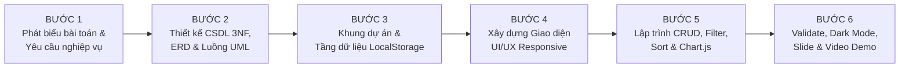

# HƯỚNG DẪN TOÀN DIỆN CHO NGƯỜI 5: THỐNG KÊ, BIỂU ĐỒ CHART.JS, SLIDE BÁO CÁO & VIDEO DEMO 3 PHÚT

> **Dự án:** Cafe Task Manager — Hệ Thống Quản Lý Công Việc & Vận Hành Quán Cafe  
> **Môn học:** Phát triển ứng dụng Web — Trường Đại học CMC (Khoa CNTT&TT)  
> **Giai đoạn:** Bài Tập Giữa Kỳ (Frontend + LocalStorage + Chart.js + Chuẩn bị thiết kế CSDL/UML)  
> **Thành viên phụ trách:** **Người 5**

---

## MỤC LỤC
1. [Tổng Quan Tiến Trình Dự Án (Từ Đầu Đến Cuối)](#1-tổng-quan-tiến-trình-dự-án-từ-đầu-đến-cuối)
2. [Vị Trí & File Code Phụ Trách Của Người 5](#2-vị-trí--file-code-phụ-trách-của-người-5)
3. [Chi Tiết Kỹ Thuật: statistics.html & assets/js/stats.js](#3-chi-tiết-kỹ-thuật-statisticshtml--assetsjsstatsjs)
4. [Bộ Slide Thuyết Trình Báo Cáo Chuẩn Mực (12 Slide)](#4-bộ-slide-thuyết-trình-báo-cáo-chuẩn-mực-12-slide)
5. [Kịch Bản Quay Video Demo 3 Phút Chuẩn Rubric 100đ + 10đ Bonus](#5-kịch-bản-quay-video-demo-3-phút-chuẩn-rubric-100đ--10đ-bonus)
6. [Hướng Dẫn Chạy Thử & Kiểm Thử Hệ Thống](#6-hướng-dẫn-chạy-thử--kiểm-thử-hệ-thống)

---

## 1. TỔNG QUAN TIẾN TRÌNH DỰ ÁN (TỪ ĐẦU ĐẾN CUỐI)

### 1.1. Khung 6 Bước Chuẩn Hóa
Quy trình làm dự án Web từ đầu đến cuối được đồng bộ giữa **yêu cầu Bài Giữa Kỳ (Client-side Web)** và **định hướng mở rộng Cuối Kỳ (Fullstack ASP.NET Core MVC)**:



- **Bước 1: Xác định yêu cầu nghiệp vụ**
  - Đối tượng: Quản lý quán cafe (giám sát, thống kê) và Nhân viên Barista/Phục vụ/Thu ngân (nhận việc, cập nhật tiến độ).
  - Chức năng cốt lõi (MVP): Quản lý công việc (CRUD), Tìm kiếm & Lọc đa tiêu chí, Lưu trữ LocalStorage, Thống kê biểu đồ Chart.js.
- **Bước 2: Thiết kế Cơ sở dữ liệu & Luồng hệ thống (Phục vụ báo cáo)**
  - Xác định các thực thể: `Roles`, `MenuCategories`, `MenuItems`, `CafeTables`, `Employees`, `Customers`, `Orders`, `OrderDetails`.
  - Chuẩn hóa 3NF: Loại bỏ đa trị (1NF) -> Phụ thuộc hàm đầy đủ (2NF) -> Loại bỏ phụ thuộc bắc cầu (3NF).
  - Sơ đồ ERD và SQL Script chèn đủ **5 dòng dữ liệu mẫu cho mỗi trạng thái**.
  - Mô tả luồng hoạt động bằng lời và vẽ sơ đồ **UML Activity Diagram**.
- **Bước 3: Khởi tạo Khung Dự án & Data Contract**
  - Cấu trúc cây thư mục chuẩn: `index.html`, `tasks.html`, `statistics.html`, `assets/css/`, `assets/js/`.
  - Quy ước cấu trúc Task trong LocalStorage (`CAFE_TASKS`): `{ id, title, description, deadline, priority, status }`.
- **Bước 4: Xây dựng Giao diện Responsive**
  - Bootstrap 5, FontAwesome 6, Google Fonts, màu sắc cà phê ấm áp, hỗ trợ Dark Mode.
- **Bước 5: Lập trình Logic Nghiệp vụ**
  - `taskService.js`: CRUD LocalStorage, Clear All, Export/Import JSON.
  - `tasks.js`: Quản lý danh sách, Modal Thêm/Sửa, Validation realtime, Lọc và sắp xếp.
  - `stats.js`: Tính toán KPI, vẽ 3 biểu đồ Chart.js tự động cập nhật.
- **Bước 6: Kiểm thử, Báo cáo & Video Demo**
  - Đóng gói GitHub, Slide báo cáo 12 trang, Video Demo 3 phút đúng chuẩn rubric.

---

## 2. VỊ TRÍ & FILE CODE PHỤ TRÁCH CỦA NGƯỜI 5

| Mục | Chi tiết |
| :--- | :--- |
| **Thành viên** | **Người 5** |
| **Vai trò chính** | **Chuyên viên Thống Kê, Trực quan hóa Dữ liệu (Chart.js), Giới thiệu & Demo** |
| **File code phụ trách** | 1. `statistics.html`<br>2. `assets/js/stats.js` |
| **Trách nhiệm báo cáo** | • Tổng hợp nội dung làm Slide thuyết trình.<br>• Viết kịch bản và quay Video Demo 3 phút đáp ứng đủ 7 tiêu chí bắt buộc + tiêu chí bonus. |

---

## 3. CHI TIẾT KỸ THUẬT: `statistics.html` & `assets/js/stats.js`

### 3.1. Các Khối Chức Năng Trên `statistics.html`
1. **Header & Navbar:** Nhận diện thương hiệu cafe, nút chuyển Dark/Light Mode, nút Export JSON, menu Responsive drawer trên Mobile.
2. **Khối Nhận Xét Quản Trị Tự Động (Management Insights):** Tự động phát hiện việc quá hạn, đánh giá tỷ lệ hoàn thành ca làm theo màu sắc (Xanh / Vàng / Đỏ).
3. **Bộ 6 Thẻ KPI Vận Hành:**
   - Tổng công việc (`#stat-total-tasks`)
   - Tỷ lệ hoàn thành kèm thanh tiến độ (`#stat-completion-rate`)
   - Đã hoàn thành - Done (`#stat-done-tasks`)
   - Chờ thực hiện - Pending (`#stat-pending-tasks`)
   - Ưu tiên cao - High Priority (`#stat-high-priority`)
   - Cận hạn / Quá hạn (`#stat-due-soon`)
4. **Hệ Thống 3 Biểu Đồ Chart.js:**
   - **Biểu đồ 1 (Doughnut):** Tỷ lệ trạng thái (Done vs Pending).
   - **Biểu đồ 2 (Bar Chart):** Phân bổ độ ưu tiên (High / Medium / Low).
   - **Biểu đồ 3 (Horizontal Bar):** Tiến độ công việc theo danh mục / bộ phận quán (Pha chế, Kho, Thu ngân, Vệ sinh).
5. **Bảng Việc Khẩn Cấp (Action Required):** Hiển thị danh sách việc High Priority đang Pending, có nút tick "Xong" nhanh để cập nhật ngay.
6. **Khu Vực Giới Thiệu Nhóm Dự Án (About Team):** Thẻ thông tin 5 thành viên với chức năng và phân công rõ ràng.
7. **Khu Vực Liên Hệ Quán Cafe:** Địa chỉ, hotline, giờ mở cửa và Form gửi phản hồi góp ý.

### 3.2. Điểm Nhấn Kỹ Thuật Của `assets/js/stats.js`
- **Tương thích Dark/Light Mode:** Sử dụng MutationObserver theo dõi thuộc tính `data-theme` trên thẻ `<html>` để tự động đổi màu chữ, lưới tọa độ và tooltip của Chart.js.
- **Tính năng Phản ứng Realtime:** Lắng nghe sự kiện `window.addEventListener('tasks:changed', ...)` từ `taskService.js` và `storage` event để biểu đồ tự vẽ lại ngay khi có thay đổi dữ liệu mà không cần tải lại trang.

---

## 4. BỘ SLIDE THUYẾT TRÌNH BÁO CÁO CHUẨN MỰC (12 SLIDE)

### Slide 1: Trang Bìa
- **Tiêu đề:** ĐỒ ÁN GIỮA KỲ: HỆ THỐNG QUẢN LÝ CÔNG VIỆC VẬN HÀNH QUÁN CAFE (CAFE TASK MANAGER)
- **Môn học:** Phát Triển Ứng Dụng Web — Trường Đại Học CMC
- **Giảng viên hướng dẫn:** [Tên Giảng Viên]
- **Nhóm sinh viên thực hiện:** Nhóm 5 thành viên (Người 1, Người 2, Người 3, Người 4, Người 5)
- **Người thuyết trình:** Người 5 (Đại diện nhóm báo cáo)

### Slide 2: Đặt Vấn Đề & Mục Tiêu Đề Tài
- **Bối cảnh:** Vận hành quán cafe gặp nhiều vấn đề: quên kiểm kê kho đầu ca, máy pha cà phê chưa vệ sinh, ca trực giao việc miệng dễ sót việc.
- **Giải pháp:** Xây dựng ứng dụng web quản lý công việc (Cafe Task Manager) gọn nhẹ, trực quan, hỗ trợ đa thiết bị và không phụ thuộc server nặng nề nhờ lưu trữ LocalStorage.
- **Đối tượng sử dụng:**
  - Quản lý quán: Giao việc, kiểm tra tiến độ, theo dõi biểu đồ thống kê.
  - Barista & Nhân viên phục vụ: Xem việc trong ca, đánh dấu hoàn thành nhanh.

### Slide 3: Kiến Trúc Kỹ Thuật & Cấu Trúc Dự Án
- **Công nghệ tuân thủ đề bài:** HTML5, CSS3, JavaScript ES6 thuần, Bootstrap 5, FontAwesome 6, Chart.js, SweetAlert2.
- **Mô hình phân tầng Client-side:**
  - `taskService.js` (Tầng dữ liệu LocalStorage)
  - `tasks.js` & `stats.js` (Tầng nghiệp vụ & Biểu đồ)
  - `style.css` (Giao diện chuẩn hóa Dark/Light Mode)
- **Tổ chức 3 trang độc lập:** `index.html` (Trang chủ), `tasks.html` (Quản lý việc), `statistics.html` (Báo cáo thống kê).

### Slide 4: Thiết Kế Cơ Sở Dữ Liệu & Chuẩn Hóa 3NF (Báo Cáo)
- **8 Bảng thực thể:** `Roles`, `MenuCategories`, `MenuItems`, `CafeTables`, `Employees`, `Customers`, `Orders`, `OrderDetails`.
- **Quá trình chuẩn hóa:**
  - *1NF:* Tách danh sách món thành các dòng nguyên tử trong `OrderDetails`.
  - *2NF:* Tách thuộc tính phụ thuộc toàn bộ vào khóa chính ghép (`OrderID`, `LineNumber`).
  - *3NF:* Tách `Roles`, `MenuCategories` để loại bỏ phụ thuộc bắc cầu.
- **Dữ liệu mẫu trên SQL Server:** Đã sinh đủ 5 dòng dữ liệu mẫu cho mỗi trạng thái nghiệp vụ.

### Slide 5: Sơ Đồ ERD & Luồng Hoạt Động Hệ Thống (UML)
- **Sơ đồ ERD:** Trình bày mối quan hệ 1-N giữa Danh mục - Món, Nhân viên - Đơn hàng, Đơn hàng - Chi tiết đơn.
- **Sơ đồ UML Activity Diagram:** Luồng kiểm tra điều kiện ràng buộc khi thêm/sửa/xóa task: kiểm tra Title rỗng, Deadline quá hạn, xác nhận xóa (Confirm).

### Slide 6: Giao Diện Trang Chủ (index.html)
- Phong cách thiết kế ấm áp của quán cà phê hiện đại.
- Banner giới thiệu hệ thống, khối điểm nổi bật, lời chứng thực và điều hướng nhanh sang bàn làm việc.
- Hoàn toàn responsive trên điện thoại di động và máy tính bảng.

### Slide 7: Chức Năng Quản Lý Công Việc (CRUD & Validation)
- **Create / Update:** Modal popup tiện lợi, kiểm tra hợp lệ dữ liệu trực tiếp khi gõ (Realtime Validation).
- **Read:** Hiển thị trực quan dạng thẻ/bảng, phân biệt rõ màu sắc giữa Pending và Done (gạch ngang, đổi màu).
- **Delete:** Hộp thoại xác nhận an toàn trước khi xóa.
- **Toggle Done:** Đổi nhanh trạng thái chỉ với 1 cú click.

### Slide 8: Thanh Công Cụ Tìm Kiếm, Bộ Lọc Kết Hợp & Phân Trang
- **Search:** Tìm kiếm tức thì theo từ khóa trong tiêu đề và mô tả.
- **Filter kết hợp:** Lọc đồng thời theo Trạng thái (Pending/Done) và Độ ưu tiên (High/Medium/Low).
- **Sort:** Sắp xếp theo Deadline gần nhất hoặc xa nhất.
- **Pagination:** Phân trang thông minh khi danh sách công việc lớn.

### Slide 9: Trung Tâm Báo Cáo & Thống Kê (statistics.html - Điểm Nhấn Người 5)
- **Bộ 6 chỉ số KPI:** Đo lường chính xác tỷ lệ hoàn thành ca làm việc.
- **3 Biểu đồ Chart.js trực quan:**
  - Biểu đồ tròn: Trạng thái Done vs Pending.
  - Biểu đồ cột: Mức độ ưu tiên High - Medium - Low.
  - Biểu đồ ngang: Khối lượng công việc theo bộ phận quán.
- **Cơ chế Reactive & Insights:** Tự động nhận xét tiến độ ca làm và tự cập nhật biểu đồ khi dữ liệu thay đổi.

### Slide 10: Các Điểm Cộng Đạt Trọn Điểm Bonus (+10 Điểm)
- **Vẽ biểu đồ bằng Chart.js:** Trực quan, mượt mà, hỗ trợ cả màn hình in/PDF.
- **Đồng bộ Dark Mode / Light Mode:** Lưu trạng thái vào LocalStorage, biểu đồ tự thích ứng màu sắc.
- **Sao lưu & Phục hồi (Export/Import JSON):** Cho phép xuất tệp `.json` để sao lưu và nạp lại dữ liệu bất cứ lúc nào.
- **Clear All an toàn:** Xóa toàn bộ công việc với cảnh báo xác nhận, giữ nguyên cấu hình giao diện.

### Slide 11: Đánh Giá Kết Quả Theo Rubric Điểm (100đ + 10đ Bonus)
- UI đẹp + Responsive + Điều hướng: 15/15đ
- CRUD đầy đủ, chạy ổn định: 25/25đ
- Search + Filter + Sort + Pagination: 15/15đ
- LocalStorage lưu trữ bền vững: 15/15đ
- Validation + Toast/Alert UX: 10/10đ
- Tổ chức mã nguồn sạch, module hóa: 10/10đ
- Demo & Báo cáo rõ ràng: 10/10đ
- **Điểm Bonus (Chart.js + Dark Mode + Export/Import JSON): +10đ**
- **Tổng điểm mục tiêu: 110 / 100 điểm**

### Slide 12: Tổng Kết & Định Hướng Mở Rộng Cuối Kỳ
- Hệ thống giải quyết trọn vẹn bài toán vận hành quán cafe ở quy mô MVP phía Client.
- **Kế hoạch mở rộng Bài Cuối Kỳ:** Chuyển đổi sang Backend **ASP.NET Core MVC**, nạp CSDL SQL Server thông qua **Entity Framework Core (Code First / Scaffolding)**, quản lý ca trực phân quyền chi tiết.
- Cảm ơn Thầy Cô và Hội đồng đã lắng nghe! (Phần Q&A).

---

## 5. KỊCH BẢN QUAY VIDEO DEMO 3 PHÚT CHUẨN RUBRIC (100đ + 10đ BONUS)

> **Thời lượng video:** Đúng 03 phút (180 giây).  
> **Người thực hiện demo:** Người 5.  
> **Yêu cầu kỹ thuật:** Bật trình duyệt ở độ phân giải 1080p, mở sẵn trang `index.html`.

| Thời gian | Phân cảnh & Thao tác trên màn hình | Lời thoại thuyết minh (Voiceover Script) |
| :--- | :--- | :--- |
| **00:00 - 00:25**<br>*(25 giây)* | **Mở đầu & Giới thiệu tổng quan:**<br>- Bắt đầu từ `index.html`.<br>- Cuộn chuột lướt nhanh qua banner, tính năng.<br>- Bấm nút chuyển đổi Dark / Light Mode trên thanh Navbar. | *"Xin chào Thầy và các bạn! Em là đại diện Nhóm 5, sau đây em xin trình bày video demo 3 phút sản phẩm Bài tập giữa kỳ môn Phát triển ứng dụng Web: Website Quản lý Vận hành Quán Cafe - Cafe Task Manager. Ứng dụng được xây dựng hoàn toàn bằng HTML5, CSS3 và JavaScript thuần theo kiến trúc mô-đun, hỗ trợ Dark/Light mode và lưu trữ dữ liệu bền vững trên LocalStorage."* |
| **00:25 - 00:50**<br>*(25 giây)* | **Tiêu chí 1: Thêm mới công việc & Validation (Create):**<br>- Bấm chuyển sang trang `tasks.html`.<br>- Bấm nút "Thêm công việc".<br>- Cố tình để trống ô tiêu đề và bấm Lưu -> Hiện lỗi validation đỏ.<br>- Nhập dữ liệu hợp lệ: `Nhập hạt cà phê Arabica mới`, chọn hạn chót ngày mai, độ ưu tiên `High`, bấm Thêm. | *"Đầu tiên là tính năng Thêm công việc mới có Validation chặt chẽ: Hệ thống kiểm tra realtime, không cho phép tiêu đề rỗng, mô tả tối thiểu 10 ký tự và deadline không được ở quá khứ. Sau khi nhập hợp lệ và lưu, công việc mới ngay lập tức hiển thị trên danh sách và có thông báo Toast góc màn hình mà không cần reload trang."* |
| **00:50 - 01:15**<br>*(25 giây)* | **Tiêu chí 2 & 3: Cập nhật, Toggle Done & Reload trang (Read & Update & LocalStorage):**<br>- Bấm nút tick tròn đổi trạng thái task sang `Done` -> Chữ đổi màu xanh, gạch ngang.<br>- Bấm nút "Sửa", đổi độ ưu tiên từ High sang Medium, bấm Lưu.<br>- **Bấm nút F5 (Reload lại trang):** Danh sách dữ liệu vẫn giữ nguyên vẹn 100%. | *"Tiếp theo là tính năng cập nhật: Em có thể click một chạm để chuyển trạng thái sang Hoàn thành, giao diện lập tức đổi màu xanh và gạch ngang chữ. Thao tác Sửa thông tin cũng diễn ra mượt mà qua Modal. Đặc biệt, khi em nhấn F5 tải lại toàn bộ trang, toàn bộ dữ liệu vừa tạo và sửa đổi vẫn được bảo toàn nguyên vẹn nhờ cơ chế lưu trữ LocalStorage."* |
| **01:15 - 01:40**<br>*(25 giây)* | **Tiêu chí 4 & 5: Tìm kiếm, Bộ lọc kết hợp & Sắp xếp (Search, Filter, Sort):**<br>- Gõ từ khóa `Arabica` vào ô tìm kiếm -> Bảng lọc ngay lập tức.<br>- Xóa ô tìm kiếm, chọn lọc Trạng thái `Pending` kết hợp Độ ưu tiên `High`.<br>- Bấm chọn Sắp xếp theo Deadline gần nhất. | *"Thứ ba là bộ công cụ Tìm kiếm và Lọc đa tiêu chí: Tìm kiếm realtime theo từ khóa; Lọc kết hợp đồng thời giữa Trạng thái và Độ ưu tiên; Sắp xếp theo hạn chót Deadline gần nhất hoặc xa nhất giúp quản lý quán cafe dễ dàng kiểm soát các đầu việc khẩn cấp."* |
| **01:40 - 02:05**<br>*(25 giây)* | **Tiêu chí 6: Xóa công việc có hộp thoại xác nhận (Delete with Confirm):**<br>- Bấm nút "Xóa" một công việc bất kỳ.<br>- Xuất hiện hộp thoại popup Confirm cảnh báo nguy hiểm.<br>- Bấm Đồng ý -> Task biến mất kèm hiệu ứng mượt và Toast thông báo. | *"Thứ tư là chức năng Xóa công việc: Để tránh việc nhân viên bấm nhầm, hệ thống luôn bật hộp thoại Confirm cảnh báo trước thao tác nguy hiểm. Khi xác nhận, công việc sẽ được xóa an toàn khỏi LocalStorage."* |
| **02:05 - 02:35**<br>*(30 giây)* | **Tiêu chí Bonus: Trang Báo cáo & Thống kê biểu đồ Chart.js (statistics.html):**<br>- Bấm vào mục "Báo cáo & Thống kê" trên Navbar để sang `statistics.html`.<br>- Trình bày các thẻ KPI tổng hợp.<br>- Chỉ chuột vào 3 biểu đồ Chart.js (Doughnut, Bar Chart, Category Chart).<br>- Bấm nút Dark Mode để thấy biểu đồ tự đổi màu thích ứng. | *"Và đây là phần tính năng cộng điểm Bonus đặc biệt do Người 5 phát triển: Trang Báo cáo & Thống kê toàn diện với 6 thẻ chỉ số KPI tự động tính toán. Tích hợp thư viện Chart.js vẽ 3 biểu đồ trực quan từ dữ liệu thực trong LocalStorage: Tỷ lệ hoàn thành Done/Pending, Phân bổ độ ưu tiên và Tiến độ theo từng bộ phận quán. Biểu đồ tự động cập nhật thời gian thực và tương thích hoàn hảo với cả chế độ Dark Mode."* |
| **02:35 - 03:00**<br>*(25 giây)* | **Tiêu chí 7 & Bonus cuối: Responsive di động & Xuất/Nhập JSON:**<br>- Bấm F12 thu nhỏ cửa sổ trình duyệt về kích thước Mobile (375px) -> Hiện menu Hamburger, danh sách và biểu đồ co giãn mượt mà.<br>- Bấm nút "Xuất JSON" -> File `cafe-tasks.json` được tải về máy.<br>- Kết thúc video. | *"Cuối cùng là khả năng Responsive 100%: Khi thu nhỏ màn hình điện thoại di động, thanh menu chuyển sang dạng Hamburger drawer và toàn bộ layout co giãn chuẩn xác, không bị vỡ giao diện. Hệ thống cũng hỗ trợ Xuất và Nhập file JSON an toàn. Nhóm em đã hoàn thành đầy đủ tất cả các yêu cầu bắt buộc và tính năng cộng điểm. Em xin chân thành cảm ơn Thầy đã theo dõi!"* |

---

## 6. HƯỚNG DẪN CHẠY THỬ & KIỂM THỬ HỆ THỐNG

### 6.1. Chạy trên máy tính cá nhân
1. Mở thư mục dự án trong **Visual Studio Code**.
2. Cài đặt extension **Live Server** (nếu chưa có).
3. Nhấp chuột phải vào file `index.html` chọn **Open with Live Server**.
4. Trình duyệt tự động mở tại địa chỉ `http://127.0.0.1:5500/index.html`.

### 6.2. Kiểm thử nhanh các tính năng của Người 5
1. Mở trang `statistics.html`.
2. Mở cửa sổ Console trình duyệt (`F12`):
   ```javascript
   // Kiểm tra toàn bộ danh sách task hiện có
   TaskService.getAllTasks();

   // Thêm một task mới qua code để kiểm tra biểu đồ tự cập nhật
   TaskService.addTask({
     title: 'Pha chế mẻ Cold Brew ủ lạnh 24h',
     description: 'Ủ mẻ cà phê Cold Brew dung tích 10 lít phục vụ cho ngày mai',
     deadline: '2026-10-26',
     priority: 'High',
     status: 'Pending'
   });

   // Quan sát trang statistics.html: Biểu đồ và thẻ KPI tự động nhảy số ngay lập tức!
   ```
3. Bấm vào nút **In / Lưu PDF** trên đầu trang `statistics.html` để kiểm tra bản in báo cáo chuyên nghiệp.

---
*Tài liệu được tổng hợp và chuẩn hóa cho Đồ án Giữa kỳ Môn Phát Triển Ứng Dụng Web — Người 5.*

